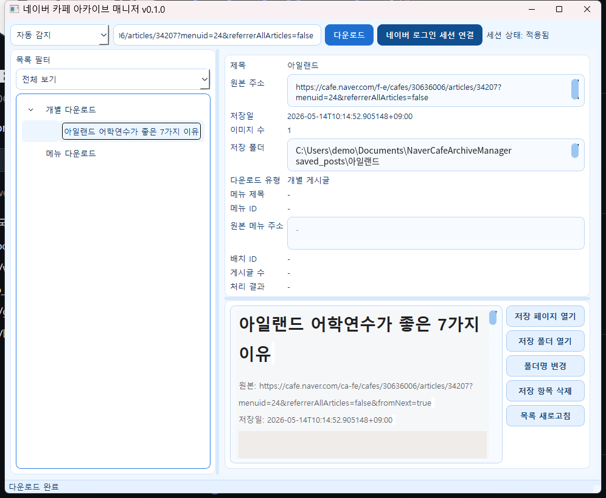
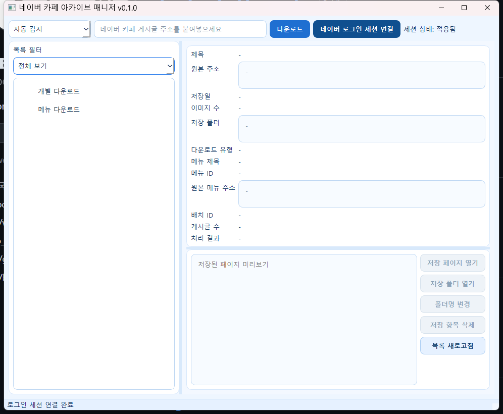

# Naver Cafe Posts Downloader

[한국어](README.md) | [English](docs/README.en.md) | [日本語](docs/README.ja.md) | [中文](docs/README.zh-CN.md)

네이버 카페에서 **본인이 열람할 권한이 있는 게시글**을 Windows PC에 개인용으로 보관하고, 로컬 HTML로 다시 볼 수 있게 해 주는 데스크톱 도구입니다. 앱에는 **Naver Cafe Archive Manager**라는 이름으로 표시됩니다.



> [!IMPORTANT]
> 이 프로젝트는 네이버 또는 네이버 카페의 공식 제품이 아닙니다. 네이버 이용약관, 카페 운영정책, 저작권 및 개인정보 관련 법규를 확인하고 준수해 주세요.

## 주요 기능

- 개별 게시글 URL 다운로드
- 지원되는 카페 메뉴 URL에서 게시글을 수집하는 일괄 작업
- 본문, 이미지, 메타데이터 및 로컬 열람용 `view.html` 저장
- 저장한 글 목록 보기, 폴더/로컬 페이지 열기 및 확인 후 삭제
- 중복 글 건너뛰기, 진행 상황 표시 및 일괄 작업 취소
- 별도 Chromium 프로필을 이용한 사용자 직접 로그인

네이버의 페이지 구조나 정책이 바뀌면 다운로드 기능이 작동하지 않을 수 있습니다. 접근 권한, 회원 등급, 비공개 글 또는 기타 플랫폼 제한을 우회하지 않습니다.

## 다운로드

Windows 64비트용 배포본: [v0.1.0 릴리스](https://github.com/Bum-Boo/Naver-Cafe-Posts-Downloader/releases/tag/v0.1.0) · [ZIP 직접 다운로드](https://github.com/Bum-Boo/Naver-Cafe-Posts-Downloader/releases/download/v0.1.0/NaverCafeArchiveManager-v0.1.0-win64.zip)

ZIP을 원하는 위치에 풀고 `NaverCafeArchiveManager.exe`를 실행해 주세요. 실행 파일과 함께 있는 `data/`, `saved_posts/` 및 `ms-playwright/`가 런타임에 사용됩니다. 개인 데이터가 들어 있는 폴더를 배포본에 포함하지 마세요.

## 소스에서 실행

Windows, Python 3 및 인터넷 연결이 필요합니다.

```powershell
python -m venv .venv
.venv\Scripts\Activate.ps1
pip install -r requirements.txt
python -m playwright install chromium
python app.py
```

## 사용 방법

1. `네이버 로그인 세션 연결`을 눌러 열린 Chromium 창에서 직접 로그인합니다.
2. 로그인 확인 후 게시글 URL 또는 지원되는 메뉴 URL을 붙여 넣습니다.
3. `Download`를 누르고 진행 상황을 확인합니다.
4. 저장 목록에서 항목을 선택해 로컬 페이지나 폴더를 엽니다.

로그인 정보는 앱 전용 `data/browser_profile/`과 백업 상태 파일 `data/auth/naver_state.json`에 로컬로 저장됩니다. 비밀번호 자체를 저장하지는 않지만, 세션 파일에는 계정 접근에 사용될 수 있는 민감한 쿠키가 들어 있으므로 공유·커밋·백업 업로드를 하지 마세요. 삭제하려면 앱을 종료한 뒤 `data/browser_profile/`과 `data/auth/`를 제거하세요.

저장 결과는 기본적으로 `saved_posts/<제목>/` 아래의 `content.txt`, `content.html`, `view.html`, `meta.json`, `images/`에 생성되며, 목록 인덱스는 `data/archive_index.json`에 저장됩니다.

## 미리 보기



[URL 입력](docs/demo-screenshots/naver-live-02-url-entered.png) · [다운로드 결과](docs/demo-screenshots/naver-live-04-download-result.png) · [저장 항목](docs/demo-screenshots/naver-live-05-saved-item-selected.png) · [로컬 페이지](docs/demo-screenshots/naver-live-06-local-page.png)

## 책임 있는 사용

- 본인이 정상적으로 열람하고 개인 보관할 수 있는 콘텐츠에만 사용해 주세요.
- 비공개·저작권 보호 콘텐츠를 재배포하거나 대량 수집하지 마세요.
- 자동화 빈도와 범위는 서비스에 부담을 주지 않도록 제한해 주세요.
- 생성된 HTML에는 원문 콘텐츠와 이미지가 포함될 수 있습니다. 보관·삭제·공유 책임은 사용자에게 있습니다.

## 프로젝트 상태

현재 공개 버전은 `v0.1.0`이며 Windows 중심의 초기 릴리스입니다. 자동화된 테스트 모음은 저장소에 포함되어 있지 않습니다. 자세한 조작은 [USAGE.md](USAGE.md), Windows 패키징은 [패키징 안내](packaging/windows/README_PACKAGING.md)를 참고하세요.

## 라이선스와 출처 표기 요청

현재 저장소에는 별도의 라이선스 파일이 없습니다. 따라서 공개되어 있다는 사실만으로 복제·수정·재배포 권한이 부여된다고 가정하지 마세요. 법적 허용 범위와 권한은 각자 확인해야 합니다.

이 프로젝트를 소개하거나 허가를 받아 파생 작업에 활용하신다면 `@Bum-Boo`와 [원본 저장소](https://github.com/Bum-Boo/Naver-Cafe-Posts-Downloader)를 함께 언급해 주시면 감사하겠습니다. 이는 정중한 요청일 뿐 라이선스 의무를 추가하거나 대체하지 않습니다.
